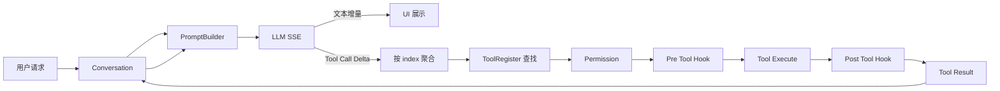
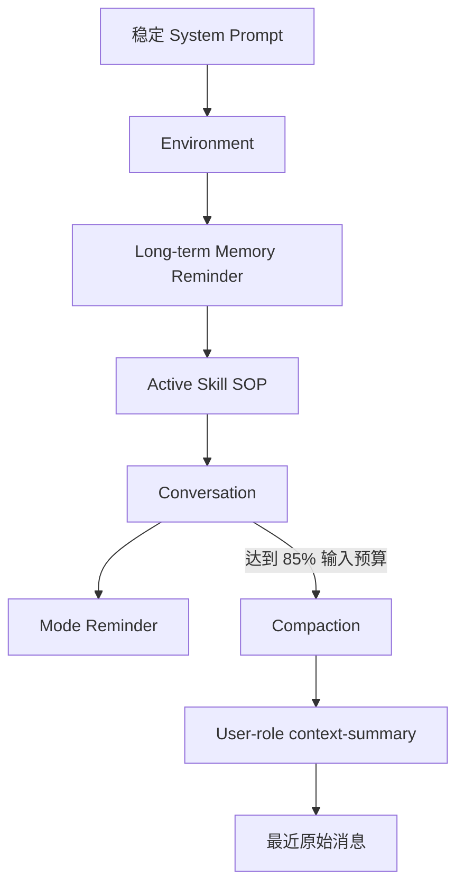
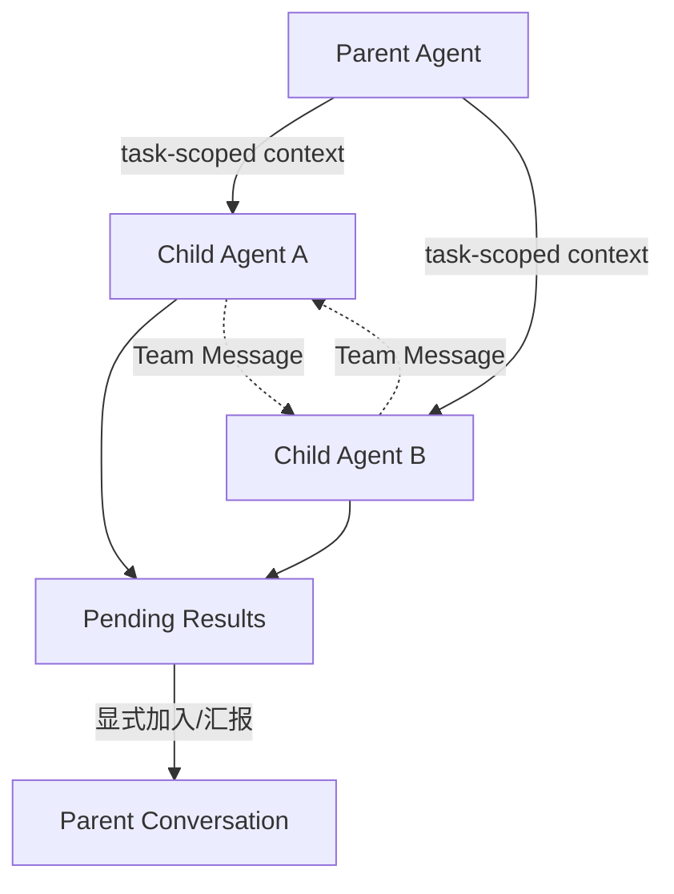
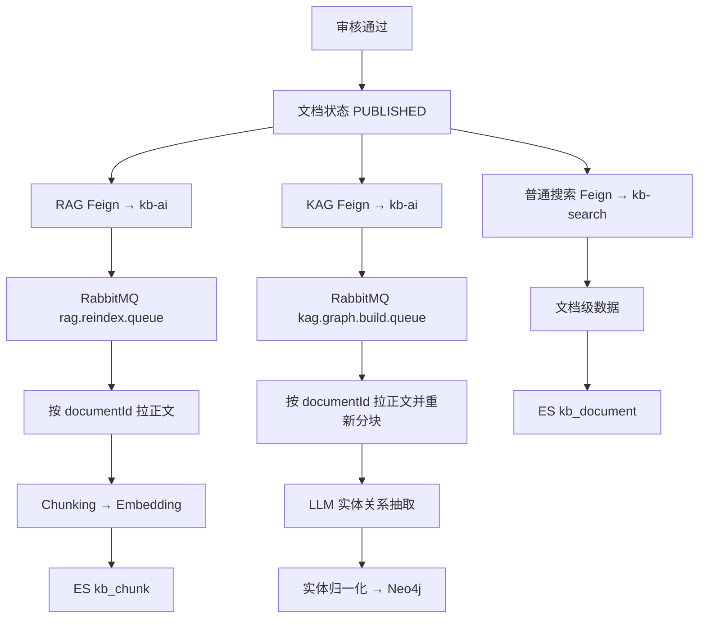
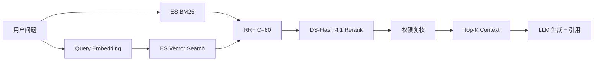

---
aliases:
  - B站二面复习
  - Agent项目一小时冲刺
tags:
  - 面试/B站
  - Agent
  - CodingAgent
  - RAG
  - 企业知识库
created: 2026-09-23
updated: 2026-09-23
status: 冲刺复习
review_time: 60min
---

# B站二面 Agent 与企业知识库一小时冲刺

> [!abstract] 今晚的目标
> 用 **1 小时**把两个项目讲成清晰、可信、能经受追问的工程故事。
> 
> 答题统一使用：**结论 → 主链路 → 关键实现 → 失败与边界 → 改进方案**。

> [!danger] 一面暴露出的四个最高风险点
> 1. 危险命令混淆绕过：不能只回答 Prompt + 正则。
> 2. 100 多个 MCP 工具：不能回答“这是用户的问题”。
> 3. Multi-Agent 上下文：不能只讲同步、异步和 Team，要先讲隔离。
> 4. 项目边界：不能把参考项目、设计方案和当前已实现能力混在一起。

## 资料导航

- Coding Agent 详细实现：[[Project_Software/MewCode/实现/Day-3 ReAct 与Agent Loop]]
- 上下文治理：[[Project_Software/MewCode/实现/Day-7 上下文管理]]
- MCP：[[Project_Software/MewCode/实现/Day-6 MCP]]
- Skill：[[Project_Software/MewCode/实现/Day-10 Skills]]
- Hook：[[Project_Software/MewCode/实现/Day-11 Hook]]、[[Project_Software/MewCode/实现/Day-12 Hook]]
- SubAgent：[[Project_Software/MewCode/实现/Day-12 SubAgent]]
- Worktree：[[Project_Software/MewCode/实现/Day-13 Worktree]]
- Agent Team：[[Project_Software/MewCode/实现/Day-14 Agent Teams]]
- 企业知识库简历口径：[[Project_Software/企业智能知识库/企业智能知识库_简历包装]]
- 文档发布后的真实链路：[[Project_Software/企业智能知识库/文档发布后RAG_KAG_ES索引构建全流程]]
- RAG 专题：[[Project/_Software/企业智能知识库/17-语雀批次04-第19到20章-RAG/README]]
- Rerank 改进：[[Project/_Software/企业智能知识库/17-语雀批次04-第19到20章-RAG/RAG改进设想与Reranker方案]]
- 权限模型：[[系统设计/权限设计/OBAC]]
- 模拟方法：[[面试补漏/面试模拟提问指南]]

---

## 一小时复习计划

| 时间 | 复习任务 | 完成标准 |
| --- | --- | --- |
| 0—5 分钟 | 背两个 90 秒项目介绍 | 不看稿讲清问题、链路、贡献、边界 |
| 5—18 分钟 | Coding Agent 主链路 | 2 分钟完整讲出 Prompt 到 Tool Result Loop |
| 18—32 分钟 | 权限、MCP、Context、Multi-Agent | 四题都能在 60 秒内回答 |
| 32—44 分钟 | 企业知识库 | 画出入库三链路和在线检索链路 |
| 44—52 分钟 | 系统设计追问 | 能讲故障、一致性、权限、评测 |
| 52—57 分钟 | 闭卷录音 | 连续答四道高风险题 |
| 57—60 分钟 | 只看速记卡 | 不再扩展新知识 |

### 闭卷检查清单

- [ ] 我能解释为什么 Summary 不是 System Reminder。
- [ ] 我能解释危险命令为什么不能只用关键词匹配。
- [ ] 我能准确说出当前 Tool Search 是怎么匹配的。
- [ ] 我能解释 Pending Result 为什么不能立即写进父 Conversation。
- [ ] 我不会再把 Worktree 说成复制整个仓库。
- [ ] 我能画出审核通过后的 RAG、KAG、普通搜索三条链路。
- [ ] 我能解释 RRF、DS-Flash 4.1 重排和失败降级。
- [ ] 我能解释 OBAC 为什么必须下推到检索阶段。

---

# 两个项目的 90 秒介绍

> [!example] Coding Agent 90 秒版本
> 我做的是一个基于 Java 21 的本地 Coding Agent 和 Agent 工作台。做这个项目，是因为我在使用现有 Coding Agent 时遇到了模型供应商切换不灵活、长对话上下文膨胀、工具结果过大、权限边界不透明，以及子 Agent 结果容易干扰主任务等问题，所以我想从 Agent Harness 的底层链路出发自己实现一遍。
>
> 核心链路是：用户请求进入 Conversation 后，PromptBuilder 组合系统提示、环境、长期记忆、激活的 Skill、历史消息和工具 schema；模型通过 SSE 返回文本或 Tool Call；Agent 聚合工具参数，从注册表找到工具，依次经过权限检查、Pre Tool Hook、工具执行和 Post Tool Hook，再把 Tool Result 写回历史，触发下一轮模型调用，直到模型不再调用工具或命中终止条件。
>
> 我重点做了三类治理：第一是上下文治理，包括摘要压缩、近期消息保留和大工具结果落盘；第二是扩展机制，包括 MCP、Skill 和 Hook；第三是协作机制，包括独立上下文的 Subagent、Team、Pending Result、Checkpoint 和 Git Worktree。
>
> 这个项目目前是可运行的工程原型，不是生产级沙箱。例如危险命令识别仍有正则规则的局限，Worktree 完成了基础隔离，但自动冲突分析与合并闭环还没有全部完成。

> [!example] 企业知识库 90 秒版本
> 我参与开发的是一个面向企业内部知识沉淀与复用的微服务知识库系统，覆盖文档管理、审核发布、普通搜索、RAG 问答和 KAG 知识图谱。
>
> 文档上传时，原文件存入 RustFS，文件和文档业务元数据存 MySQL，解析后的完整正文存 MongoDB。文档审核通过后并行触发三条派生数据链路：RAG 通过 RabbitMQ 异步分块、Embedding，并把 Chunk、元数据和向量写入 Elasticsearch `kb_chunk`；KAG 异步重新分块，用 LLM 抽取实体关系并写入 Neo4j；普通搜索则直接通过 Feign 把文档级数据写入 Elasticsearch `kb_document`。
>
> 在线问答时，在 `kb_chunk` 中并行进行 BM25 和向量检索，用 RRF（C=60）融合名次，再用 DS-Flash 4.1 对候选 Chunk 统一重排，取 Top-K 构造 Prompt 并生成带引用的答案。KAG 场景还可以根据问题实体做图谱关系扩展，补充跨文档关联信息。
>
> 项目采用“业务主数据先提交、派生索引最终一致”的思路，但当前死信队列、补偿对账、事务提交后发事件，以及复杂 PDF 表格图片解析仍有完善空间。

---

# Coding Agent 主链路

> [!tip] 一句话主链路
> `Prompt → SSE → Tool Call → Permission → Pre Hook → Execute → Post Hook → Tool Result → Next Loop`

> [!question]- Q1：项目整体架构是什么？
> **答：**我把它分成七层：
> 
> 1. 交互层：CLI、React Web IDE、权限确认和事件可视化。
> 2. Agent Runtime：Agent Loop、迭代上限、中断和事件队列。
> 3. Prompt/Context：Prompt 构建、token 预算、摘要、大结果落盘和长期记忆。
> 4. 模型适配层：统一 `LLMClient` 适配不同供应商和 SSE 语义。
> 5. Tool 层：`Tool` 接口、注册表、内置工具和 MCP Wrapper。
> 6. 安全扩展层：Permission、Hook、Skill。
> 7. 协作持久化层：Subagent、Team、Pending Result、Session、Checkpoint、Worktree。
> 
> **一面问题：**当时回答成了“为什么没用框架”，没有真正回答架构。

> [!question]- Q2：为什么不用 Spring AI 或 LangChain4j？
> **答：**不是因为框架不好，而是项目目标就在 Harness 层。我需要直接控制 Prompt 稳定前缀、SSE 解析、Tool Call 聚合、权限门禁、上下文压缩和多 Agent 合并。
> 
> 代价是协议兼容、异常恢复、可观测性都要自己负责。普通业务 Agent 会优先选成熟框架；只有需要研究 Harness 或深度定制时才保留从零实现。

> [!question]- Q3：“读取文件、修改代码并运行测试”的完整执行流程是什么？
> **答：**
> 
> 1. 用户消息写入 Conversation，启动一次 Run。
> 2. 每轮处理超大 Tool Result，再构建 Prompt。
> 3. Prompt 包含系统规则、环境、Memory、active Skill、Conversation、模式提示和工具 schema。
> 4. SSE 解析器把响应封装成文本、Tool Call、Error 和 End 事件。
> 5. Tool Call 的参数可能分帧返回，按 index 聚合完整 JSON。
> 6. 按 Tool Name 从注册表取工具，解析工作区参数并做权限检查。
> 7. 权限通过后依次执行 Pre Hook、Tool 和 Post Hook。
> 8. Tool Result 作为 tool message 写回 Conversation，重新请求模型。
> 9. 没有 Tool Call 时结束；中断、流错误、上下文耗尽或达到迭代上限时异常结束。

> [!question]- Q4：Tool 查找需要反射或 switch 吗？
> **答：**不需要。每个工具实现统一 `Tool` 接口，启动时注册到 `Map<String, Tool>`。模型返回 Tool Name 后直接按名称查找。MCP 工具也包装成同一个接口，因此走统一执行链路。
> 
> **不要再说：**“没有 Spring Bean，所以只能通过 switch 或反射找类。”

> [!question]- Q5：SSE 是怎么解析的？
> **答：**SSE 是一次 HTTP 长连接中的多条 event/data 帧，不是几百次 HTTP 请求。
> 
> content delta 可以即时推给 UI；Tool Call 的 id、name、type 和 arguments 可能拆在多帧里，所以按 index 分别累积，明确结束后再反序列化参数。OpenAI-compatible 可根据 `finish_reason` 或 `[DONE]` 结束；DeepSeek 适配器严格等待 `[DONE]`，如果连接提前断开则报错，不能把半截响应当成功。

---

# 上下文与记忆

> [!question]- Q6：上下文治理有哪三层？
> **答：**
> 
> 1. 单个 Tool Result 超过约 50K 字符时落盘，Conversation 只保留预览和文件位置。
> 2. 同一条 tool message 的结果总量超过约 200K 字符时，从最大结果开始继续落盘。
> 3. 输入达到可用预算的 85% 时摘要旧 Conversation，至少保留最近 6 条原始消息，并保护 Tool Call/Tool Result 边界。
> 
> **纠正：**不是“每个 loop 的工具结果总量”，而是当前实现中的“单条 tool message 总量”。

> [!question]- Q7：摘要 Prompt 保存什么？失败怎么办？
> **答：**保存用户目标与约束、架构决策、文件/类/方法/配置、已完成工作和测试、错误及修复、未完成任务和下一步。删除寒暄、重复、过期讨论和无关工具输出。
> 
> 摘要请求不带工具；只有完整成功后才替换历史。失败时原 Conversation 保持不变；连续失败达到上限后熔断自动压缩，避免每轮重复消耗模型请求。

> [!question]- Q8：压缩摘要为什么是 user role，不是 system role？
> **答：**`<context-summary>` 表示压缩后的历史数据，不是更高权限的系统规则，所以作为 user-role 消息放在近期原始消息之前。
> 
> 同时，频繁变化的摘要不应该插入稳定的 system 前缀，否则容易破坏 Prompt Cache。长期记忆和 active Skill 才是独立的 system message。
> 
> **一面错误：**把 Summary、System Reminder 和 Prompt Cache 混在了一起。

> [!question]- Q9：多次摘要会不会丢信息？
> **答：**会，所以目标是降低风险，不是宣称绝不丢失。
> 
> - 强制保留目标、约束、决策、文件、测试、问题和下一步。
> - 保留近期原始消息。
> - 摘要成功前不改历史。
> - Session 保存完整执行轨迹。
> - 超大结果落盘后可以回读。
> - 进一步可以使用结构化摘要槽位，而不是只依赖自然语言总结。

> [!question]- Q10：Session 和长期记忆有什么区别？
> **答：**Session 保存一次会话的完整消息快照，用于恢复；长期记忆只保存跨轮次稳定的用户偏好、项目事实和约束。长期记忆独立召回并作为 system reminder 注入，不写进普通 Conversation，也不直接保存工具原始输出。

---

# 权限与 Hook

> [!danger] 必背结论
> **关键词正则只能做快速过滤，不能成为 Shell 安全边界。**

> [!question]- Q11：当前权限链路怎么做？
> **答：**
> 
> 1. 明显危险 Bash 命令先做快速拒绝。
> 2. 文件路径转成绝对规范路径，项目外访问进入 ASK 或拒绝。
> 3. 会话可以记录允许规则，但创建持久 Hook 不能被静默放行。
> 4. 权限模式按工具类别决定 ALLOW、ASK、DENY，询问超时默认拒绝。
> 5. 权限通过后仍要过 Pre Tool Hook。
> 
> 当前不是完整 Shell 沙箱，危险命令识别仍有有限正则的局限。

> [!question]- Q12：模型用变量、编码、嵌套 shell 隐藏危险命令怎么办？
> **答：**不能只靠关键词匹配，我会分五层处理：
> 
> 1. 对命令标准化并做 Shell AST/结构化解析，识别 executable、参数、管道、重定向、命令替换和嵌套 shell。
> 2. 对路径做 canonicalize，解析 `..`、符号链接、大小写和挂载点。
> 3. 对 `bash -c`、`python -c`、PowerShell 编码命令、`eval`、下载后执行提高风险等级。
> 4. 无法可靠解析时 fail closed，拒绝或进入人工确认。
> 5. 最后用最小权限进程、只读挂载、容器/沙箱、网络和资源限制兜底。
> 
> **核心句：**任意 Shell 的安全性无法靠正则静态证明，所以要用结构化解析、默认拒绝和运行时隔离共同兜底。

> [!question]- Q13：Hook 如何加载和执行？
> **答：**Hook 配置保存在项目 `.mycoder/hooks/hooks.json`。启动时读取并校验完整配置，然后原子替换 Dispatcher 中启用的 definitions。运行时修改 Hook 时，也是先验证新快照、原子落盘，再替换运行状态。
> 
> Dispatcher 根据 event 和 selector 匹配 Tool Name、参数和结果状态，再执行 Command、HTTP 或 Prompt Action。Pre Tool Hook 可以拒绝；Post Tool Hook 只能观察，因为工具副作用已经发生。
> 
> **边界：**TURN_START/TURN_END 事件类型可以存在，但当前主链路真正接通的是 Pre/Post Tool，不能把“Prompt 前后 Hook”说成完整已实现。

---

# MCP Tool Search 与 Skill

> [!question]- Q14：MCP 如何接入 Agent？
> **答：**MCP Manager 连接 Server，通过 `listTools` 获取 schema，再把远程工具包装成统一 Tool 接口注册。模型调用时，Wrapper 把参数交给 MCP Client，结果转换成统一 Tool Result，因此 MCP 和本地工具共用 Agent Loop。

> [!question]- Q15：100 多个 MCP 工具怎么治理？
> **答：**
> 
> 1. 所有工具先进入外部 Tool Index，初始 Prompt 只放基础工具和精简目录。
> 2. 按 Server、业务域、权限、参数类型和副作用做硬过滤。
> 3. 用 BM25/关键词和 embedding 召回候选，再按成功率、近期使用和权限重排。
> 4. 每轮只激活 Top-K 完整 schema，并限制 schema token 预算。
> 5. 低置信度时向用户澄清。
> 6. 对已激活工具做会话缓存或 TTL，防止工具集无限膨胀。
> 
> **禁止回答：**“用户只应该配置需要的工具，这是用户的问题。”

> [!question]- Q16：当前 Tool Search 是关键词匹配吗？
> **答：****是，MewCode 参考实现当前是简单的大小写不敏感子串匹配。**
> 
> - query 转小写。
> - 判断 query 是否是 deferred tool 的 name 或 description 的子串。
> - `select:ToolName,AnotherTool` 按名称精确选择。
> - 命中后标记为 discovered，完整 schema 从后续请求开始可用。
> - 不是 BM25、向量搜索或 LLM rerank，多词 query 也没有完善分词。
> 
> 面试口径：“原型用 name/description substring 验证延迟加载闭环；规模扩大后升级为元数据过滤 + BM25/embedding 混合召回 + rerank。”

> [!question]- Q17：多个工具描述相似，怎么让 Agent 精确选择？
> **答：**先按业务域、参数类型、权限和副作用做硬过滤；元数据写清适用、不适用、前置条件和正反例；再做关键词与语义召回和 rerank；只把 Top-K schema 给模型。Priority 只能做同分 tie-breaker，不能代替检索和判别。

> [!question]- Q18：Skill 的加载机制是什么？
> **答：**两层渐进披露：
> 
> 1. 发现层只注入 Skill name 和 description。
> 2. 模型调用 `LoadSkill` 后把 Skill 标为 active，完整 SOP 不放 Tool Result，而在下一轮作为 system message 注入。
> 
> active Skill 不写入 Conversation，但会在当前会话后续请求持续生效，直到 unload、clear 或会话重置；它不会一轮结束就自动消失，也不会被 Conversation 摘要掉。

---

# Multi-Agent Team Checkpoint Worktree

> [!question]- Q19：Multi-Agent 的上下文怎么管理？
> **答：**每个 child 拥有新的 Agent 和新的 Conversation，独立维护历史、token 预算、迭代状态和事件流。父 Agent 只下发 task-scoped context：目标、约束、工作目录、交付物、接口和验收条件。
> 
> 工具注册表可以克隆后过滤；权限模式可以继承，但项目根和危险命令检查仍独立执行。子 Agent 只返回结构化结果或摘要，不能把内部所有工具轨迹直接塞进父历史。
> 
> **一面问题：**当时回答了三种调度方式，却没有回答“上下文如何隔离”。

> [!question]- Q20：同步 Subagent、异步 Subagent、Team 有什么区别？
> **答：**
> 
> - 同步 Subagent：父 Agent 阻塞等待，适合短而强依赖的任务。
> - 异步 Subagent：立即返回 handle，child 在独立线程运行，结果进入 Pending Result。
> - Team：增加共享任务板、明确收件人的邮箱、成员状态和报告，适合持续协作；成员不共享完整 Conversation。

> [!question]- Q21：为什么异步结果要进入 Pending Result？
> **答：**child 完成时父 Agent 可能还在生成、调用工具或已经改变方向。直接写父 Conversation 会产生并发写入、顺序不确定、重复注入和上下文污染。
> 
> 因此结果先按 session + child + run 幂等保存；只有显式“加入对话/汇报”才修改父 Conversation，处理后标记 reported，并保留审计记录。

> [!question]- Q22：三种 Merge Strategy 是什么？
> **答：**
> 
> 1. `ROLLBACK_CHECKPOINT`：回到创建子任务时的对话状态再注入结果；一致性高，但会丢弃父 Agent 后续进展，必须确认。
> 2. `SUMMARIZE_GAP_THEN_MERGE`：把 checkpoint 后父进展和子结果摘要成一致状态；紧凑但有摘要损失。
> 3. `RAW_APPEND`：直接追加原文；透明但可能重复、冲突并消耗 token。
> 
> 当前服务层有策略原型，但工作台入口后来简化为“加入对话/标记已读”。不要宣称三种策略已经形成稳定 UI 闭环。

> [!question]- Q23：Checkpoint 能恢复代码吗？
> **答：**当前是 Conversation-only Checkpoint，只保存消息快照。恢复会保留原会话、不重放工具、不修改项目文件。它不是 Git 快照或完整状态机。

> [!question]- Q24：Worktree 是复制整个项目吗？
> **答：**不是。`git worktree add -b <branch> <path> HEAD` 创建独立工作目录和分支，但共享 Git object database，通常比完整复制仓库轻。
> 
> 当前完成 create/list/remove/changes 等基础隔离；自动写集合预测、路径冲突检测、commit、merge/cherry-pick 和冲突解决还没有全部闭环。

> [!question]- Q25：Team 是否已经形成完整调度系统？
> **答：**已经有独立 Agent/Conversation、共享任务表、原子 claim、明确邮箱、成员状态、权限请求和每轮报告；但任务表不是完整 DAG，成员完整历史未完全跨进程恢复，Worktree 也未自动分配和合并。因此准确定位是“跑通关键隔离和协作状态的工程原型”。

---

# 企业知识库真实架构

## 数据职责

| 存储 | 数据 | 作用 |
| --- | --- | --- |
| RustFS | 原始 PDF、Word、Markdown 等二进制 | 对象存储、下载和生命周期 |
| MySQL `tb_file` | 文件 hash、路径、大小、类型 | 文件元数据和秒传 |
| MySQL `kb_document` | 文档业务元数据、状态、`content_id` | 业务主记录 |
| MongoDB `document_content` | 解析后的完整正文、版本 | 灵活正文存储 |
| ES `kb_chunk` | Chunk、元数据、embedding | RAG BM25 + 向量检索 |
| ES `kb_document` | 文档级搜索副本 | 普通搜索、过滤、高亮 |
| Neo4j | Document、Chunk、Entity、关系 | KAG 与知识图谱 |
| Redis | 任务进度、缓存 | 加速与运行状态 |

## 审核通过后的三条派生链路

> [!important] 三条链路不是同一份索引复制三遍
> - `kb_chunk`：Chunk 级 RAG。
> - Neo4j：图关系和 KAG。
> - `kb_document`：文档级普通搜索。

## 在线 RAG 链路

> [!question]- Q26：文档完整入库链路是什么？
> **答：**上传后先解析文件，原始二进制通过文件服务写入 RustFS，文件元数据写 MySQL `tb_file`；文档业务元数据写 MySQL `kb_document`；解析后的完整正文写 MongoDB，并用 `content_id` 关联。
> 
> 刚上传是草稿，不会立即建索引。只有发布并审核通过后，才异步构建 RAG、KAG 和普通搜索三类派生数据。

> [!question]- Q27：RAG 索引如何构建？
> **答：**文档服务通过 Feign 通知 `kb-ai`，`kb-ai` 把只包含 taskId 和 documentId 的任务发进 RabbitMQ。消费者按 ID 回拉最新正文，删除旧 Chunk，按标题、段落和句子边界分块，保留 overlap，批量生成 embedding，再把 Chunk、元数据和向量 Bulk 写入 ES `kb_chunk`。
> 
> 消息只传 ID，不传全文，可以避免 MQ 承载大文本，也避免消费到过期正文副本。

> [!question]- Q28：为什么先按标题切，再按 token/长度切？
> **答：**标题和段落是自然语义边界，先按结构切让每个 Chunk 尽量表达一个主题；再按上限切控制 embedding 和生成模型预算。相邻块保留 overlap，降低边界信息丢失。
> 
> 要保存 `titlePath、chunkIndex、totalChunks、source、version`，方便相邻扩展、引用、删除和重建。

> [!question]- Q29：为什么 BM25 和向量检索要并行？
> **答：**BM25 擅长错误码、专有名词和精确短语；向量检索擅长语义相近但字面不同的内容。两者互补，并行还能降低串行延迟。

> [!question]- Q30：RRF 是什么？为什么不直接加两个分数？
> **答：**RRF 使用排名而不是原始分数：
> 
> `score(d) = Σ 1 / (C + rank_i(d))`，当前口径 `C=60`。
> 
> BM25 分数和向量相似度不在同一量纲，直接相加需要复杂标定；RRF 对分数尺度不敏感，能稳定融合两路排名。

> [!question]- Q31：DS-Flash 4.1 如何做重排？
> **答：**RRF 先把候选收敛到 10—20 条，再把 query 和带稳定 ID 的候选一次性交给 DS-Flash 4.1 做 listwise 相关性排序，最后取 Top-K。
> 
> 输出必须做 JSON Schema、ID、重复和分数校验；超时或解析失败时回退到 RRF 排名，不能让整个检索不可用。

> [!question]- Q32：项目的向量检索是 HNSW 吗？
> **答：**当前源码口径是 ES `match_all + script_score + cosineSimilarity` 全库计分，不应包装成 HNSW ANN。数据规模变大后才需要调整 dense_vector index 和 kNN/HNSW 参数，并通过 Recall/Latency 评测确定方案。

> [!question]- Q33：KAG 是怎么做的？
> **答：**KAG 消费者按 documentId 拉正文并重新分块，在 Neo4j 创建 Document 和 Chunk 节点；逐 Chunk 调 LLM 抽取实体和关系，经同名、别名和编辑距离归一化后创建 KnowledgeEntity。
> 
> 文档到 Chunk 用 `HAS_CHUNK`，Chunk 到实体用 `MENTIONS`，实体关系当前统一使用 `RELATED_TO`，具体语义保存在 `relation` 属性里。不要说已经实现很多独立 Relationship Type。

> [!question]- Q34：Neo4j 是否参与在线问答？
> **答：**项目包装口径中，KAG 查询会从问题抽取实体，在 Neo4j 做最多 2 跳关系遍历，反向找到关联 Chunk，再与 RAG 结果融合，用于跨文档关系问题。
> 
> 要主动说明当前工程缺口：RAG 与 KAG 会分别重新分块并生成随机 Chunk ID，ES 与 Neo4j 的 Chunk 不能天然一一对齐；更稳妥的方案是统一分块阶段生成稳定 Chunk ID，再把同一批 Chunk 分发给 RAG 和 KAG。

---

# 权限 OBAC 与安全

> [!question]- Q35：企业知识库的 OBAC 怎么设计？
> **答：**OBAC 根据“用户与具体对象的关系 + 对象当前状态”判断权限。
> 
> - Subject：用户、部门、用户组、角色。
> - Object：知识库、目录、文档、Chunk。
> - Action：read、write、upload、delete、manage、share。
> - Relation/Policy：用户是对象所有者、团队成员、审核人、被分享人，以及对象是否草稿、审核中、已发布。
> 
> 对象可以按知识库 → 目录 → 文档 → Chunk 继承权限；显式 deny 优先。MySQL 保存关系和版本，检索时把 tenantId、teamId、knowledgeBaseId、documentId 或 permissionTag 下推到 ES 查询。

> [!question]- Q36：为什么不能先检索，生成后再过滤无权内容？
> **答：**如果无权 Chunk 已经进入 Prompt，敏感信息已经传给模型，也可能进入摘要、引用、缓存和日志。权限必须在召回阶段下推；相邻 Chunk 扩展、Rerank、KAG、缓存和引用下载都必须使用同一个授权上下文，返回前再做一次对象权限复核。

> [!question]- Q37：允许访问的 documentId 太多，怎么过滤？
> **答：**不能无限展开 ID：
> 
> 1. 索引保存 tenant、team、knowledgeBase、permissionTags，先结构化过滤。
> 2. 对大 ACL 建主体到对象的倒排集合或 bitmap。
> 3. 公共、团队、私有文档分层或分区。
> 4. 权限结果使用带 permission version 的短 TTL 缓存。
> 5. 业务层最终复核，避免索引权限更新延迟导致越权。

---

# 一致性 故障 评测

> [!question]- Q38：为什么审核通过后索引失败不回滚文档状态？
> **答：**MySQL/MongoDB 是业务主数据，RAG、KAG、ES 搜索是可重建的派生数据。项目采用“业务主数据先提交 + 派生索引最终一致”，避免 Embedding、MQ 或 Neo4j 短暂故障阻塞审核。
> 
> 代价是文档可能已发布但暂时搜不到，所以必须有任务状态、重试、死信、对账和重建入口。

> [!question]- Q39：当前最终一致性有哪些真实缺口？
> **答：**
> 
> - RAG/KAG 设置了死信交换机名，但未完整声明可用 DLX/DLQ。
> - `basicNack(..., false, false)` 失败后不重新入队。
> - 审核事务内直接启动 `CompletableFuture`，异步线程可能早于事务提交读到旧状态。
> - 当前没有完整统一的补偿对账调度器。
> 
> 改进：`@TransactionalEventListener(AFTER_COMMIT)` 或 Outbox 发布事件；明确 DLQ；任务表记录阶段和失败原因；幂等消费者；定期 reconciliation。

> [!question]- Q40：如何保证多存储更新和删除一致？
> **答：**以 MySQL documentId、version 和 index task 为真值。新版本全部构建成功后再切 ACTIVE；删除先标记不可检索，再异步清理 ES、MongoDB、Neo4j 和 RustFS。所有消费者幂等，失败可重试，后台对账修复孤儿和缺失索引。

> [!question]- Q41：如何评测 RAG？
> **答：**建立“问题—相关 Chunk—标准答案”数据集，分三层评测：
> 
> - 召回：Recall@K、MRR、NDCG，比较 BM25、Vector、RRF、Rerank。
> - 生成：正确性、完整性、忠实性和拒答。
> - 引用：引用是否支持结论、document/page/chunk 是否准确、是否越权。
> 
> 在线监控无答案率、反馈、各阶段延迟、token 成本和失败率。没有评测数据时不能说“命中率提升多少”。

> [!question]- Q42：PDF 表格和图片怎么精准解析？
> **答：**当前完成度主要在结构化文本和 RAG/KAG 主链路，复杂 PDF 解析不是最强部分。
> 
> 生产方案：文本层直接抽取；扫描件走 OCR；表格做结构识别并转 Markdown/HTML；图片做 OCR 或视觉模型 caption；保存 page、bbox、type 和 reading order；分块时保护表格和代码块完整，并抽样人工验收解析准确率。

---

# 一面逐题复盘

| 问题 | 一面表现 | 二面必须修正 |
| --- | --- | --- |
| Coding Agent 架构 | 回答成不用框架 | 先讲七层架构和完整数据流 |
| 上下文治理 | 三层思路较好 | 修正 tool message 总量和 Summary role |
| Prompt Cache | 与 System Reminder 混淆 | 强调稳定前缀，变化摘要放 Conversation |
| 权限 | 能说危险命令、路径、HITL | 补结构化解析、fail closed、沙箱 |
| 危险命令混淆 | Prompt + 正则，没有回答绕过 | 今晚最高优先级 |
| Worktree | 说成复制仓库、自动合并 | 共享对象库；自动合并未闭环 |
| MCP 100+ | 说成用户问题 | Tool Index、Top-K Schema、预算与缓存 |
| 相似工具 | 只说优先级和描述 | 硬过滤、正反例、召回、Rerank |
| Skill | 说只生效一轮 | Active Skill 会持续到 unload/clear |
| Multi-Agent Context | 回答成三种调度 | 先讲独立 Agent/Conversation |
| Checkpoint | 说保存整份记忆 | Conversation-only，不恢复文件 |
| 企业知识库 | 检索链路基本正确 | 加审核发布三链路和最终一致性 |
| Neo4j | 一面说只做展示 | 按当前项目文档补 KAG 查询，但说明 ID 对齐缺口 |
| PDF 解析 | 明确没做 | 诚实边界 + 给生产设计 |
| 最难问题 | 只说 Prompt 重构很烦 | 改讲 SSE 提前结束 Bug |
| 算法题 | 指针状态反复 | 今晚少投入，写前先定义不变量 |
| 反问 Code Review | 有价值 | 二面继续问 Agent 评测与质量门禁 |

---

# 最难问题标准故事

> [!example] SSE 提前结束 Bug
> 我遇到过一次 Agent Loop 提前结束的问题：UI 看起来流式回答完成，但 Tool Call 参数有时只有半截；DeepSeek thinking 模式下正文为空时也可能被错误判断成结束，导致工具没有执行或下一轮没有触发。
>
> 我先用 Postman 保存原始 SSE 帧，对比正常和异常响应，把解析过程拆成 content、tool call delta、finish reason 和 DONE 四类状态。最终发现不能用“content 为空”判断结束，因为工具参数和 reasoning 可能在后续帧；Tool Call arguments 也必须按 index 累积。
>
> 修复后解析器改成有状态聚合：文本增量即时展示，工具字段分别累积，明确结束后再反序列化。OpenAI-compatible 根据 finish reason/DONE 结束，DeepSeek 严格等待 DONE；连接提前断开则报错，不把不完整结果写成成功。最后补普通文本、分片 Tool Call、thinking、异常断流和中断测试。

---

# 二面高概率追问

> [!question]- Q43：工具已经产生副作用，进程挂了怎么恢复？
> **答：**为 Run 和 Tool Call 记录唯一 ID、状态和副作用等级。只读工具可重试；写工具需要幂等键、事务或补偿；恢复时先判断工具是否已提交，不能盲目重放 Conversation。不可幂等的外部命令交给用户确认。

> [!question]- Q44：如何防止 Tool Result 中的 Prompt Injection？
> **答：**工具、网页和文档内容全部视为不可信数据，用明确标签隔离；系统规则声明不能执行数据里的指令；高风险动作仍经过独立权限引擎，不能因为结果里写“已授权”就放行；外部内容带来源、长度限制和审计。

> [!question]- Q45：两个 Agent 同时改同一文件怎么办？
> **答：**任务先声明或预测写集合，检测冲突；同文件任务串行化，或让其中一个进入 Worktree。完成后检查 base commit、diff 和测试，再 merge/cherry-pick；冲突进入显式处理，不能最后写入覆盖。

> [!question]- Q46：检索链路如何降级？
> **答：**Query Embedding 失败时走 BM25-only；向量检索失败保留 BM25；Reranker 超时回退 RRF；KAG 故障不阻塞基础 RAG；生成模型故障返回检索证据或明确失败。每层都设置超时、熔断、指标和可观测的 fallback reason。

> [!question]- Q47：检索延迟怎么优化？
> **答：**BM25 和向量并行；限制两路候选数；RRF 本地计算；Rerank 设置 Top-N、超时和回退；批量 Embedding；合理缓存 query embedding；拆分监控 embedding、ES、RRF、Rerank、Generation 的 P50/P95/P99。

> [!question]- Q48：如何评测 Coding Agent？
> **答：**分四层：协议和工具单测；真实仓库任务的成功率与测试通过率；SWE-bench 等任务集；安全评测，包括越权路径、命令混淆、Prompt Injection 和中断恢复。同时记录 token、工具调用次数、延迟、补丁大小和人工接管率。

---

# 禁用说法与推荐句式

> [!failure] 不要再说
> - “这是用户的问题。”
> - “我测试没问题，所以应该能防住。”
> - “Worktree 就是复制整个项目，最后自动合并。”
> - “Skill 只用一轮，之后被摘要压缩。”
> - “压缩摘要放 System Reminder 里。”
> - “没有 Spring Bean，所以只能 switch/反射找 Tool。”
> - “SSE 发出来几百条请求。”
> - “当前向量检索就是 HNSW。”
> - “已经实现了完整最终一致和生产级权限。”

> [!success] 推荐句式
> - “当前版本已经完成……；还没有完成……；如果生产化我会……”
> - “这个问题不能只靠某一层，我拆成解析、策略和运行时隔离三层。”
> - “先说主链路，再解释这一层为什么存在。”
> - “这是参考实现；我借鉴的是……；我自己的版本做到……”
> - “我不把主观效果当结论，验证指标是……”

---

# 最后 3 分钟速记卡

> [!quote] 只背这 12 句话
> 1. Agent 主链路：Prompt → SSE → Tool Call → Permission → Hook → Execute → Tool Result → Loop。
> 2. 架构题先讲分层和数据流，不先讲为什么没用框架。
> 3. Summary 是 user-role 压缩历史；Memory 和 active Skill 才是 system message。
> 4. Context 三层：50K 单结果、200K tool message、85% 预算触发摘要并保留近 6 条。
> 5. 危险命令：结构化解析、canonical path、fail closed、沙箱兜底。
> 6. Pre Hook 可拒绝；Post Hook 只能观察。
> 7. 100+ MCP：外部索引、硬过滤、混合召回、Top-K schema、低置信度澄清。
> 8. 当前 Tool Search 是 name/description 小写子串匹配，生产版再升级 BM25 + embedding + rerank。
> 9. Subagent 独立 Agent/Conversation；异步结果先进入 Pending Result。
> 10. Worktree 共享 Git 对象，不是复制仓库；自动合并未闭环。
> 11. RAG：ES BM25 + Vector → RRF(C=60) → DS-Flash 4.1 → 权限复核 → Top-K → 引用回答。
> 12. OBAC 必须下推检索，绝不能让无权 Chunk 先进入 Prompt。

## 面试前最后动作

- [ ] 喝水，关闭其他窗口。
- [ ] 两个项目介绍各说一遍，不再改稿。
- [ ] 危险命令、MCP、多 Agent、OBAC 各说一遍。
- [ ] 提醒自己：先停一秒组织，再开口；不要边想边堆“然后、就是、可能”。

